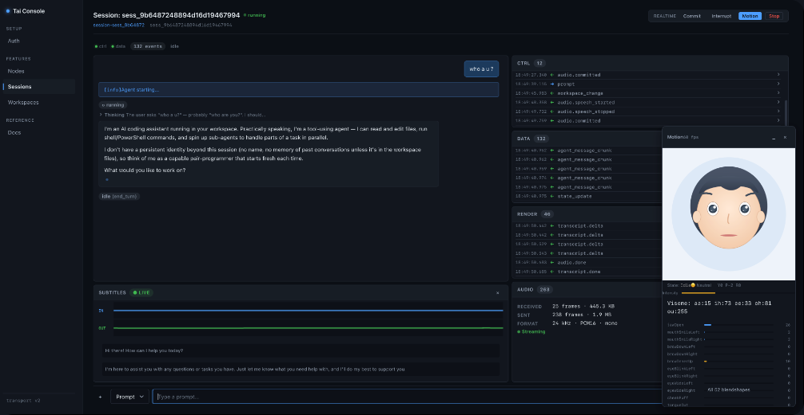

# tai-golang



Go SDK for building the **server side** of a Tai deployment.

Tai is a computer agent installed on user machines. `tai-golang` lets a Go
application accept Tai node connections and manage nodes, agent sessions,
workspaces, realtime voice, Remote Tools, and Wasm plugins.

The SDK is a library embedded in your application. It does not run an agent
itself; it owns the server-side transport, identity, session orchestration, and
business tool handlers.

## Status

Active development. The public API follows the current v2 design and may change
without backward-compatibility guarantees while the project is in development.

Working today:

- Transport server with HTTP discovery, HTTP/2 + HTTP/3 support, and connection pools
- Node registry, node lifecycle callbacks, remote node operations
- Sessions: prompt, follow-up, steer, cancel, permissions, queue, runtime updates
- Session recovery and resume
- Workspaces: files, branches, commits, history, merge, watch, context, skills
- Realtime: PCM audio, transcripts, emotion, avatar motion frames
- Remote Tools with Tool H2, progress events, and Agent integration
- Wasm plugins distributed by digest and streamed to nodes on demand
- Auth: node tokens and scoped user tokens
- Demo App with React frontend and docs browser

Not yet implemented:

- Realtime video
- ONNX integration for the balanced render preset

## Install

```bash
go get github.com/yaoapp/tai-golang
```

Requires Go 1.26+.

## Download Tai

The SDK needs Tai nodes to connect. Download the nightly build:

```bash
# macOS (Apple Silicon)
curl -sL https://get.yaoapps.com/tai/nightly/latest.json | jq -r '.assets["darwin-arm64"]' | xargs curl -L -o tai && chmod +x tai

# macOS (Intel)
curl -sL https://get.yaoapps.com/tai/nightly/latest.json | jq -r '.assets["darwin-amd64"]' | xargs curl -L -o tai && chmod +x tai

# Linux (x86_64)
curl -sL https://get.yaoapps.com/tai/nightly/latest.json | jq -r '.assets["linux-amd64"]' | xargs curl -L -o tai && chmod +x tai

# Linux (ARM64)
curl -sL https://get.yaoapps.com/tai/nightly/latest.json | jq -r '.assets["linux-arm64"]' | xargs curl -L -o tai && chmod +x tai

# Windows (PowerShell)
$url = (Invoke-RestMethod https://get.yaoapps.com/tai/nightly/latest.json).assets.'windows-amd64'
Invoke-WebRequest $url -OutFile tai.exe
```

See [latest.json](https://get.yaoapps.com/tai/nightly/latest.json) for versions,
download URLs, and SHA256 checksums.

## Quick Start

```go
package main

import (
    "context"
    "crypto/ed25519"
    "crypto/rand"
    "log"

    tai "github.com/yaoapp/tai-golang"
    "github.com/yaoapp/tai-golang/auth"
    "github.com/yaoapp/tai-golang/node"
    "github.com/yaoapp/tai-golang/types"
)

func main() {
    _, privateKey, err := ed25519.GenerateKey(rand.Reader)
    if err != nil {
        log.Fatal(err)
    }

    server, err := tai.NewServer(&tai.ServerConfig{
        TransportPort: 6099,
        HTTPPort:      5099,
        Auth:          auth.DefaultAuth(privateKey),
    })
    if err != nil {
        log.Fatal(err)
    }

    node.OnRegister(func(rn types.RemoteNode) error {
        log.Printf("node registered: %s", rn.Info().ID)
        return nil
    })

    go func() {
        if err := server.Start(context.Background()); err != nil {
            log.Print(err)
        }
    }()

    if err := server.WaitReady(context.Background()); err != nil {
        log.Fatal(err)
    }
    select {}
}
```

`auth.DefaultAuth` is a demo implementation for the complete local flow. Use a
custom `AuthProvider` in production. See [Auth](docs/auth.md).

A node then connects to the SDK:

```bash
tai start --node-id node-1 \
  --server http://localhost:5099 \
  --node-token <token> \
  --data ./tai-volumes
```

Generate the node token with `IssueNodeToken` or through your own provisioning
flow.

## Core Concepts

| Concept | Description |
| --- | --- |
| `Server` | Embedded transport, node registry, tool/plugin registries |
| `RemoteNode` | A connected node with workspace/session operations |
| `Session` | One agent conversation, commands, events, optional realtime |
| `Workspace` | Remote filesystem, branches, history, watchers |
| `AuthProvider` | Node credential and scoped user credential verification |
| `RemoteTool` | Server-side tool exposed to node Agents |
| `PluginEntry` | Wasm step for a Remote Tool pipeline |

Read [Architecture](docs/architecture.md) for the deployment model and
[API Reference](docs/api-reference.md) for a quick method lookup.

## Sessions

```go
import (
    "encoding/json"

    "github.com/yaoapp/tai-golang/node"
    "github.com/yaoapp/tai-golang/types"
)

llm, _ := json.Marshal(map[string]any{
    "primary": map[string]any{
        "provider_id": "deepseek",
        "model":       "deepseek-chat",
    },
})

rn := node.Get("node-1")
sess, err := rn.OpenSession(ctx, &types.SessionOpenRequest{
    SessionID: "sess-001",
    Scopes:    types.Scope{types.SessionAccess, types.WorkspaceRead},
    Request: &types.SessionRequest{
        Runtime: "tai",
        Cwd:     "/workspace/project",
        LLM:     llm,
        Env:     map[string]string{"DEEPSEEK_API_KEY": apiKey},
    },
})
if err != nil {
    log.Fatal(err)
}
defer sess.Close(context.Background())

if err := sess.Prompt(&types.UserMessage{Message: "Hello"}); err != nil {
    log.Fatal(err)
}

for {
    msg, err := sess.RecvEvent()
    if err != nil {
        break
    }
    log.Printf("[%s] %s", msg.Kind, msg.Data)
}
```

`OpenSession` issues the user credential from the declared scopes; there is no
operation token to pass. Use `ResumeSession` after a transport interruption.

See [Session](docs/session.md) for steering, queue management, permissions,
updates, and event handling. See [LLM Providers](docs/llm-providers.md) for model
and endpoint configuration.

## Workspaces

```go
rn := node.Get("node-1")

ws, err := rn.OpenWorkspace(ctx, "workspace-id")
if err != nil {
    log.Fatal(err)
}

branch, err := ws.GetBranch(ctx, "main")
if err != nil {
    log.Fatal(err)
}

data, err := fs.ReadFile(branch.FS(), "README.md")
if err != nil {
    log.Fatal(err)
}

w, err := branch.FS().Create("hello.txt")
if err != nil {
    log.Fatal(err)
}
_, _ = w.Write([]byte("Hello, World!"))
_ = w.Close()

if err := branch.Commit(ctx, "add hello.txt"); err != nil {
    log.Fatal(err)
}
```

Use `Rename`, `Remove`, `MkdirAll`, `WriteArchive`, `ReadManifest`, `Exists`,
history queries, merges, and watchers as needed. See
[Workspace API](docs/workspace.md).

## Remote Tools

Remote Tools expose application capabilities to node Agents:

```go
import (
    "context"
    "encoding/json"

    "github.com/yaoapp/tai-golang/pb"
    "github.com/yaoapp/tai-golang/remotetool"
)

err := server.RegisterRemoteTool(&remotetool.Tool{
    Entry: &pb.RemoteToolEntry{
        Name:        "ping",
        Group:       "dev",
        Description: "Return a message and the caller identity.",
        InputSchema: []byte(`{"type":"object","properties":{"message":{"type":"string"}}}`),
    },
    Handler: func(ctx context.Context, input []byte) ([]byte, error) {
        var req struct{ Message string `json:"message"` }
        _ = json.Unmarshal(input, &req)
        user := remotetool.User(ctx)
        return json.Marshal(map[string]any{
            "message": req.Message,
            "user_id": user.UserID,
            "team_id": user.TeamID,
        })
    },
})
if err != nil {
    log.Fatal(err)
}
```

The node exposes the tool to the Agent. Calls return to the SDK handler with a
verified user identity. Tool metadata and plugin metadata are synced to the node;
tool calls and plugin artifacts use the SDK transport port.

See [Remote Tools](docs/remote-tools.md) for pipelines, progress handlers, CLI,
and error codes.

## Plugins

A Remote Tool pipeline can include Wasm plugin steps:

```go
err := server.RegisterPlugin(&pb.PluginEntry{
    Name:         "demo.normalize",
    Version:      "1.0.0",
    Runtime:      "wasm",
    ArtifactPath: "dist/wasm/normalize.wasm",
})
```

`RegisterPlugin` reads the file once to compute `digest` and `size`, then stores
the path. The node downloads the artifact on demand; the SDK opens and streams
it from disk at that point.

See [Remote Tool Plugins](docs/remote-tool-plugins.md) for the plugin ABI,
capabilities, build commands, and pipeline examples.

## Realtime

Realtime upgrades an open session into a voice conversation:

```go
err := sess.StartRealtime(&types.RealtimeRequest{
    Providers: types.Providers{
        Primary: types.Provider{
            ProviderID: "openai",
            Model:      "gpt-realtime-mini",
            BaseURL:    "wss://api.openai.com/v1/realtime",
            APIKey:     os.Getenv("OPENAI_API_KEY"),
        },
    },
    Audio: &types.AudioConfig{
        InputFormat:  "pcm16",
        OutputFormat: "pcm16",
        SampleRate:   24000,
        Channels:     1,
        Voice:        "alloy",
    },
})
if err != nil {
    log.Fatal(err)
}

// Microphone → node.
go func() {
    for buf := range micFrames {
        if err := sess.AudioAppend(buf); err != nil {
            return
        }
    }
}()

// Node → speakers.
go func() {
    for frame := range sess.RecvAudio() {
        speaker.Play(frame.Data)
    }
}()

// Transcript and emotion.
go func() {
    for ev := range sess.RecvRender() {
        switch ev.Type {
        case "transcript.delta":
            subtitle.Append(ev.Content)
        case "transcript.done":
            subtitle.Set(ev.Transcript)
        case "emotion":
            mood.Set(ev.State, ev.Emotion, ev.Intensity)
        }
    }
}()

_ = sess.StopRealtime()
```

Do not read `RecvAction` concurrently with `StartRealtime`; start one control
relay after it returns. See [Session Realtime](docs/session-realtime.md) and
[Render Protocol](docs/render.md).

## Avatar Motion

Enable motion on the realtime request:

```go
err := sess.StartRealtime(&types.RealtimeRequest{
    Providers: providers,
    Audio:     &types.AudioConfig{OutputFormat: "pcm16", SampleRate: 24000},
    Motion: &types.MotionConfig{
        Enabled: true,
        Profile: "arkit_52",
        FPS:     30,
    },
})

go func() {
    for frame := range sess.RecvMotion() {
        avatar.ApplyBlendshapes(frame.Face, frame.Head, frame.Gaze)
    }
}()
```

Motion is optional and non-fatal; realtime continues if the motion channel is
unavailable.

## Documentation

- [Quick Start](docs/quickstart.md)
- [Architecture](docs/architecture.md)
- [API Reference](docs/api-reference.md)
- [Auth](docs/auth.md)
- [Node API](docs/nodes.md)
- [Workspace API](docs/workspace.md)
- [Session](docs/session.md)
- [Session File Inputs](docs/session-inputs.md)
- [Session Context](docs/session-context.md)
- [Session Skills](docs/session-skills.md)
- [Session Attachments](docs/session-attachments.md)
- [Session Realtime](docs/session-realtime.md)
- [Session Protocol](docs/session-protocol.md)
- [LLM Providers](docs/llm-providers.md)
- [ACP Events Reference](docs/events.md)
- [Realtime Protocol](docs/realtime.md)
- [Render Protocol](docs/render.md)
- [Resource URI Convention](docs/uri.md)
- [Remote Tools](docs/remote-tools.md)
- [Remote Tool Plugins](docs/remote-tool-plugins.md)
- [Demo App Guide](docs/demo-guide.md)

## Demo App

The repository includes a demo application that embeds the SDK and serves a
React UI plus a documentation browser.

```bash
cd app
make build

# Text sessions and docs browser
DEEPSEEK_API_KEY=<key> ./tai-demo --port 3000

# Enable realtime voice too
DEEPSEEK_API_KEY=<key> OPENAI_API_KEY=<key> ./tai-demo --port 3000
```

Open <http://localhost:3000>. See [Demo App Guide](docs/demo-guide.md).

## Project Layout

```text
server.go       Server interface, NewServer, ServerConfig
node/           Node registry, RemoteNode operations
session/        Session implementation
workspace/      Remote workspace, branches, history, watchers
remotetool/     Remote Tool registry and handlers
plugin/         Wasm plugin registry and artifact paths
auth/           AuthProvider interface + demo DefaultAuth
transport/      HTTP discovery, HTTP/2/HTTP/3 transport, frame codec
types/          Public SDK types
mock/           Test doubles
proto/          Protobuf source
pb/             Generated Go code
app/            Demo application
docs/           SDK documentation
```

## Development

```bash
go test ./...
go vet ./...
./scripts/coverage-gate.sh coverage.out
```

The demo app requires Node.js 22+ for the frontend build.

## License

Apache-2.0
