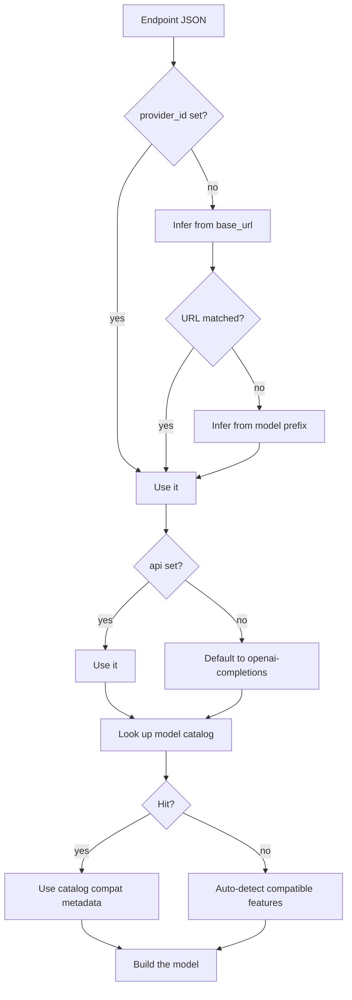

# LLM Providers

A session needs to know which model to call and how to reach it. That
configuration travels as JSON in `SessionRequest.LLM`. This page documents the
format, the roles it fills, and how the runtime resolves a model from it.

## Shape

`LLM` is a JSON object with two keys:

```json
{
  "primary": { "...endpoint..." },
  "roles": {
    "light": { "...endpoint..." },
    "realtime": { "...endpoint..." }
  }
}
```

`primary` is the model the agent uses for ordinary turns. `roles` holds
alternatives for specific purposes. Both hold the same endpoint layout.

### Endpoint fields

Field names follow `yao/llm`'s `Provider` joined with `Model`, which mirror
PiG's `ai.Provider` / `ai.Model`.

| Field | Source | Required | Purpose |
|-------|--------|:---:|---------|
| `provider_id` | `Provider` | no | Provider identifier: `deepseek`, `openai`, `anthropic`, `moonshotai`, `google`, `openrouter`, `together`, `groq` |
| `api` | `Provider` | no | Wire protocol: `openai-completions` or `anthropic-messages`. Defaults to `openai-completions`. |
| `base_url` | `Provider` | no | API root. Defaults are provider-specific. |
| `api_key` | `Provider` | no | Credential. May be supplied through `SessionRequest.Env` instead. |
| `headers` | `Provider` | no | Extra HTTP headers sent with every request |
| `compat` | `Provider` | no | Compatibility overrides for non-standard endpoints |
| `model` | `Model` | **yes** | Model identifier, e.g. `deepseek-chat`, `gpt-4o`, `claude-sonnet-4` |
| `sampling_params` | `Model` | no | Sampling parameters, e.g. `temperature`, `top_p`, `thinking_level` |

Only `model` is strictly required. Everything else falls back, and the runtime
infers the provider when `provider_id` is absent.

### Example

```go
llmJSON := json.RawMessage(`{
  "primary": {
    "provider_id": "deepseek",
    "api": "openai-completions",
    "base_url": "https://api.deepseek.com/v1",
    "model": "deepseek-chat"
  },
  "roles": {
    "light": {
      "provider_id": "deepseek",
      "model": "deepseek-chat"
    }
  }
}`)

sess, err := n.OpenSession(ctx, &types.SessionOpenRequest{
    SessionID: "sess-001",
    Scopes:    types.Scope{types.SessionAccess},
    Request: &types.SessionRequest{
        WorkspaceID: "ws-001",
        Runtime:     "tai",
        LLM:         llmJSON,
        Env:         map[string]string{"DEEPSEEK_API_KEY": apiKey},
    },
})
```

Keeping the key in `Env` rather than in the JSON avoids writing it into a
request body that may be logged.

## Roles

`primary` covers normal turns. The roles map fills narrower purposes:

| Role | Used for |
|------|----------|
| `light` | Cheap, short tasks: titles, classification, summaries |
| `realtime` | Voice interaction through `StartRealtime` |
| `vision` | Image understanding when the primary model lacks it |
| `audio` | Speech transcription |
| `embedding` | Vector embedding |
| `decision` | Routing and decision steps |

A role that is absent falls back to `primary`. The runtime does not require any
particular role to be present.

## How a provider is resolved



Inference from `base_url` matches the host: `deepseek.com` → `deepseek`,
`openai.com` → `openai`, `anthropic.com` → `anthropic`, `moonshot.cn` → `moonshotai`,
and so on. If the URL gives no signal, the model prefix decides — `deepseek*` →
`deepseek`, `gpt-*` / `o1*` / `o3*` / `o4*` → `openai`.

This means a minimal endpoint works:

```json
{ "model": "deepseek-chat" }
```

combined with `DEEPSEEK_BASE_URL` in the environment. Explicit `provider_id` and
`api` are worth setting when the endpoint is a proxy or a self-hosted gateway
where neither the host nor the model name is recognisable.

## API protocol

Two wire protocols are supported:

| `api` | Used for | Notes |
|-------|----------|-------|
| `openai-completions` | OpenAI, DeepSeek, Moonshot, most proxies | Default |
| `anthropic-messages` | Anthropic | Thinking parameters are ignored |

Anything speaking the OpenAI Chat Completions API — including local runtimes and
aggregators — works with `openai-completions` plus a `base_url`. The runtime
applies built-in compatibility metadata for known providers and auto-detects
otherwise, so quirks such as developer-role support or thinking formats are
handled without extra configuration.

## Sampling parameters

`sampling_params` carries free-form parameters. One key is read by the runtime
today:

| Key | Type | Effect |
|-----|------|--------|
| `thinking_level` | string | Reasoning effort for models that support it |

```json
{
  "primary": {
    "model": "deepseek-chat",
    "sampling_params": { "thinking_level": "high", "temperature": 0.7 }
  }
}
```

Other keys travel with the endpoint unchanged; how they are applied is up to the
agent adapter.

## Changing models at runtime

Two operations, each with a distinct purpose.

**Update the available matrix** — `UpdateSession` replaces what the session may
choose from:

```go
newLLM := json.RawMessage(`{"primary": {"provider_id": "deepseek", "model": "deepseek-reasoner"}}`)
err := sess.UpdateSession(ctx, &types.SessionUpdateOptions{
    LLM: &newLLM,
})
```

The new matrix is parsed into the session options, and the agent republishes its
`configOptions` so a client can refresh its model selector.

**Switch the model in use** — `SetConfigOption` picks one model from the matrix:

```go
err := sess.SetConfigOption("model", &types.ConfigOptionValue{
    Type:  "id",
    Value: "deepseek-reasoner",  // a model ID the matrix offers
})
```

The agent validates the ID against its matrix, applies the switch, and emits
`config_option_update` with the new `currentValue`.

`SetConfigOption` rejects an unknown `configId`, a non-`id` value, an empty
string, or a model ID absent from the matrix.

Switching the realtime provider is separate and requires `StopRealtime` then
`StartRealtime`, since the provider is bound when the voice session opens. See
[Session Realtime](session-realtime.md).

## Credentials

Two ways to supply a key, and they differ in reach:

| Source | What happens |
|--------|--------------|
| `endpoint.api_key` | Exported to the agent subprocess as `DEEPSEEK_API_KEY`, regardless of provider |
| `SessionRequest.Env` | Forwarded verbatim, and overrides the export above |

```go
// Either:
Env: map[string]string{"DEEPSEEK_API_KEY": key}

// Or:
LLM: json.RawMessage(`{"primary": {"model": "deepseek-chat", "api_key": "sk-..."}}`)
```

`api_key` is written into the subprocess environment under the fixed name
`DEEPSEEK_API_KEY`, not a provider-specific one. For a non-DeepSeek provider,
supply the variable that provider's client reads — `OPENAI_API_KEY`,
`ANTHROPIC_API_KEY` — through `Env`, and leave `api_key` unset. The demo app does
exactly this (`app/handler_session.go:77-89`).

Because `Env` is applied after the `api_key` export, an explicit environment entry
always wins.

Prefer `Env`: putting the key there keeps it out of the request JSON that may be
logged, and it works for any provider.

## Common mistakes

- Omitting `model`. It is the only required field; everything else has a fallback.
- Using `provider` or `options`. The fields are `provider_id` and
  `sampling_params`; unknown keys are ignored during parsing.
- Expecting a partial `UpdateSession` to merge. It replaces the whole matrix.
- Calling `SetConfigOption` with a model ID the matrix does not offer. The call
  fails and the current model is unchanged.
- Putting a key in JSON when it is also needed by the agent subprocess — use
  `Env` so both paths see it.
- Setting `api: anthropic-messages` against an OpenAI-compatible proxy. The
  protocol must match what the endpoint actually speaks.
