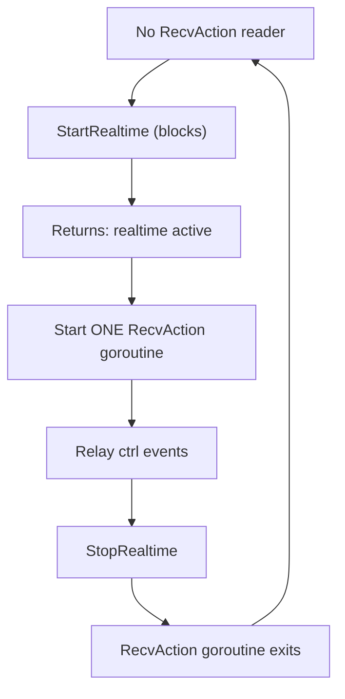

# Session Realtime

Realtime turns an open session into a voice conversation. It is an upgrade of the
session created by [Session](session.md), not a separate connection: the same ctrl
stream issues commands, and the node adds audio, render, and optionally motion
channels on top.

For the wire-level kinds and payloads, see [Realtime Protocol](realtime.md). This
page covers how an application drives realtime.

## What changes on the session

| Before `StartRealtime` | After |
|------------------------|-------|
| ctrl stream: commands and actions | same, plus realtime and audio control |
| data stream: agent events | unchanged |
| — | audio channel: PCM in and out |
| — | render stream: transcript, emotion, audio lifecycle |
| — | motion stream: avatar blendshapes, when enabled |

Realtime does **not** move events onto the data stream. Transcript and emotion
arrive on the render stream, audio on the audio channel, motion on its own
channel. That separation is why a realtime client reads four streams instead of
one.

## Starting realtime

```go
err := sess.StartRealtime(&types.RealtimeRequest{
    Providers: providers,          // required: realtime provider endpoints
    Audio: &types.AudioConfig{
        InputFormat:  "pcm16",
        OutputFormat: "pcm16",
        SampleRate:   24000,
        Channels:     1,
        Voice:        "alloy",
    },
})
if err != nil {
    return err
}
```

`StartRealtime` blocks until the node confirms with `realtime.started`, which
carries the audio and motion channel IDs. It has a 30-second deadline; a node that
never answers returns a timeout error.

### The single-reader constraint

`StartRealtime` reads the control stream internally while it waits for
`realtime.started`. **No other goroutine may be reading `RecvAction` at that
moment.**

This is the most common integration bug. The safe sequence:



In practice, keep `RecvAction` idle until `StartRealtime` returns, then start a
single relay goroutine. When stopping, wait for that goroutine to exit before
starting realtime again — a restarted session with a leftover reader will
misroute events or hang.

## Audio

Microphone input and model speech both travel as PCM frames.

```go
// Microphone → node.
for buf := range micFrames {
    if err := sess.AudioAppend(buf); err != nil {
        break
    }
}

// Node → speakers.
for frame := range sess.RecvAudio() {
    play(frame.Data)
}
```

`RecvAudio` returns a non-nil channel only after `StartRealtime` has completed.
Calling it earlier yields nil, so connect the audio sink after the start call
returns.

### Voice activity

In the default mode the provider detects speech boundaries itself. For manual
control:

| Method | Effect |
|--------|--------|
| `AudioCommit()` | Finalize the current input buffer as one utterance |
| `AudioClear()` | Discard the buffer without committing |
| `AudioInterrupt()` | Stop the model's current speech output |
| `ResponseCreate()` | Ask the model to respond to the committed input |

`AudioInterrupt` is what a "barge-in" button calls: it stops playback immediately
and signals the node that the user took over.

## Render events

`RecvRender` yields transcript, emotion, and audio lifecycle events on a dedicated
stream:

```go
for ev := range sess.RecvRender() {
    switch ev.Type {
    case "transcript.delta":
        // ev.Content holds the incremental text
    case "transcript.done":
        // ev.Transcript holds the final assistant text
    case "input_transcript.done":
        // ev.Transcript holds what the user was heard to say
    case "audio.done":
        // ev.ItemID and ev.DurationMs describe the finished speech
    case "emotion":
        // ev.State, ev.Emotion, ev.Intensity describe the expression
    }
}
```

The render stream is available whenever realtime is active. Full payloads are in
[Render Protocol](render.md).

## Motion

When the request enables motion, the node produces blendshape frames at a fixed
frame rate for a talking avatar:

```go
err := sess.StartRealtime(&types.RealtimeRequest{
    Providers: providers,
    Audio:     audioConfig,
    Motion: &types.MotionConfig{
        Enabled: true,
        Profile: "arkit_52",
        FPS:     30,
    },
})
```

```go
for frame := range sess.RecvMotion() {
    applyBlendshapes(frame.Face[:], frame.Head[:], frame.Gaze[:])
}
```

Motion is optional and non-fatal: if the motion stream fails to open, realtime
continues without it. `RecvMotion` returns a non-nil channel only when the node
reported a motion channel.

## Updating configuration

```go
err := sess.UpdateRealtime(&types.RealtimeUpdateOptions{
    Audio: &types.AudioConfig{Voice: "verse"},
})
```

`nil` fields mean "no change". Providers cannot be changed while realtime is
active — stop and start to switch providers.

The confirmation (`realtime.updated`) arrives asynchronously on the ctrl stream,
so read it from the `RecvAction` relay.

## Stopping

```go
err := sess.StopRealtime()
```

`StopRealtime` cancels the audio and render goroutines, closes the H2 audio
stream when present, and notifies the node. The session itself stays open: after
stopping, `Prompt` still works and the session can be upgraded again.

## Transport differences

The same API adapts to both transports:

| Transport | Audio | Motion |
|-----------|-------|--------|
| H3 | QUIC datagrams, demultiplexed by channel ID | QUIC datagrams |
| H2 | Dedicated bidirectional stream | Dedicated unidirectional stream |

Application code does not branch on this — `AudioAppend` and the receive channels
behave the same. Only the failure modes differ: H2 audio requires the stream to
open successfully, which is why `StartRealtime` can fail on H2 where H3 would
succeed.

## Video

`SendVideoFrame` and `RecvVideoFrame` exist in the interface but are not
implemented: the first returns an error, the second returns a nil channel. Video
is not part of realtime today.

## Common mistakes

- Running a `RecvAction` loop while calling `StartRealtime` — the start call loses
  the confirmation to the other reader and times out.
- Calling `RecvAudio` or `RecvMotion` before `StartRealtime` returns — both are nil
  until the start completes.
- Treating `StopRealtime` as session close — it only ends the voice mode.
- Assuming transcript arrives on `RecvEvent` — realtime routes it to `RecvRender`.
- Trying to swap providers with `UpdateRealtime` — that requires a stop and start.
