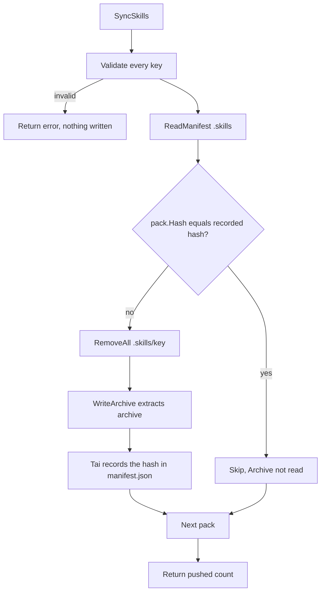

# Session Skills

A skill is a package — a `tar.gz` or `zip` archive — extracted into `.skills/`
under a key. Skill synchronization is incremental: only packages whose content
changed are pushed.

## Directory layout

```
.skills/
├── manifest.json
├── home/
│   └── SKILL.md
└── bots/
    └── postman/
        ├── SKILL.md
        └── scripts/
```

The archive is extracted as-is, so the package root becomes the key directory.
`SKILL.md` sits at that root.

`.skills/manifest.json` records `key → hash` and is maintained by Tai, not by the
caller.

## Key conventions

A key is a slash-separated relative path naming one skill directory:

| Key | Directory |
|-----|-----------|
| `home` | `.skills/home/` |
| `bots/postman` | `.skills/bots/postman/` |
| `board/dashboard-x` | `.skills/board/dashboard-x/` |

Rejected keys: empty keys, absolute paths, backslashes, and any empty, `.` or
`..` segment. `SyncSkills` validates every key before reading the manifest or
touching the workspace, so a bad key in a batch fails the whole sync with nothing
written.

## Computing a hash

Hash the archive before building the pack. `SkillHash` consumes the reader, so
hashing after constructing `SkillPack` would leave the archive empty.

```go
archive, err := os.Open("postman.tar.gz")
if err != nil {
    return err
}
defer archive.Close()

hash, err := workspace.SkillHash(archive)
if err != nil {
    return err
}
// Rewind: SkillHash read the file to the end.
if _, err := archive.Seek(0, io.SeekStart); err != nil {
    return err
}
```

## Syncing

```go
pushed, err := workspace.SyncSkills(ws, []workspace.SkillPack{
    {
        Key:     "bots/postman",
        Hash:    hash,
        Archive: archive,
    },
})
if err != nil {
    return err
}
fmt.Printf("pushed %d pack(s)\n", pushed)
```

What `SyncSkills` does:

1. Validates every key.
2. Reads `.skills/manifest.json`. A missing or unreadable manifest counts as empty.
3. For each pack, compares `pack.Hash` against the recorded hash for its key.
4. On a match, skips the pack without reading `Archive`.
5. On a difference, removes the existing directory and extracts the archive into it.

Recording the new hash is Tai's job: extracting an archive whose destination is
under `.skills/` updates `manifest.json` as part of the same operation. That is
why the next sync sees the new hash and skips.



## Idempotency

The same packs synced twice push nothing the second time:

```go
pushed, err := workspace.SyncSkills(ws, packs)
// first run:  pushed == len(packs)
// second run: pushed == 0
```

Because the manifest is keyed by hash, unchanged packages never reach
`WriteArchive`. Skipped packs do not read `Archive` at all, so a streaming reader
stays untouched.

## Verifying

```go
manifest, err := ws.ReadManifest(".skills")
if err != nil {
    return err
}
for key, hash := range manifest {
    fmt.Printf("%s = %s\n", key, hash)
}
```

Or check the extracted file directly:

```go
f, err := ws.Open(".skills/bots/postman/SKILL.md")
```

## Version control

`.skills/` stays out of workspace history. Neither the extracted content nor
`manifest.json` appears in commits or branch merges, which keeps session skill
state out of the main branch.

## Common mistakes

- Hashing after constructing the pack — the reader is already consumed.
- Forgetting to rewind the reader after `SkillHash` when reusing it.
- Using a key with a trailing slash or a doubled slash — both are rejected.
- Expecting `pushed` to reflect the number of packs submitted — it counts only
  the ones actually written.
