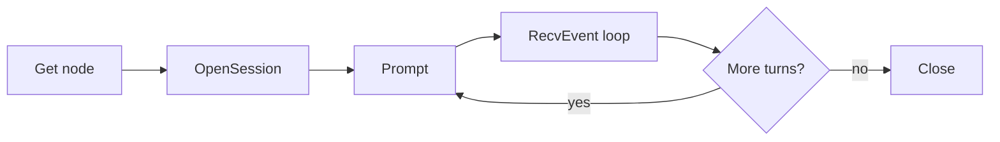
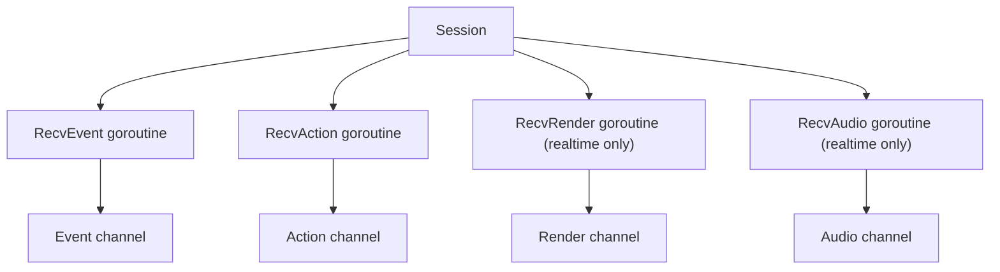

# Session

A session is one conversation with an agent running on a Tai node. Opening one
binds a workspace branch, a sandbox, and an agent process together; after that
the session carries prompts in one direction and agent events out the other.

This page covers building and driving a session. For the wire format, see
[Session Protocol](session-protocol.md). For realtime voice, see
[Session Realtime](session-realtime.md).

## Lifecycle



`OpenSession` returns as soon as the node has bound the session's resources. The
agent process starts lazily on the first `Prompt`, so an idle session costs no
subprocess.

## Prerequisites

Three things must be in place before opening a session:

| Requirement | How to get it |
|-------------|---------------|
| A connected node | Node calls `tai start` and registers; see [Quick Start](quickstart.md) |
| A node token | `auth.IssueNodeToken(nodeID)`, 7-day expiry |
| An `AuthProvider` on the server | Passed to `NewServer`; the transport uses it to issue user credentials |

Sessions without a user (scheduled jobs, unattended pool nodes) set
`SessionOpenRequest.Anonymous = true`: no identity is issued and the first
frame carries no `Payload.identity`. The daemon then has no credential to
forward for that session.

You do **not** create a user credential yourself: `OpenSession` calls
`AuthProvider.IssueUserToken(nodeID, scopes)` before opening the stream and
sends the result in the first-frame `Payload.identity`. The Tai node treats it
as an opaque string (store + forward only), so scopes must be declared by the
caller.

## Opening a session

```go
import (
    "context"

    "github.com/yaoapp/tai-golang/node"
    "github.com/yaoapp/tai-golang/types"
)

n := node.Get("demo-node")
if n == nil {
    return fmt.Errorf("node demo-node is not connected")
}

// Declare the actions the session needs. The transport issues the user
// credential from the AuthProvider with exactly these scopes.
scopes := types.Scope{types.SessionAccess, types.WorkspaceRead, types.WorkspaceWrite}

// Only "model" is required; the provider is inferred from base_url when
// provider_id is empty.
llmJSON := json.RawMessage(`{
  "primary": {"provider_id": "deepseek", "model": "deepseek-chat"}
}`)

sess, err := n.OpenSession(ctx, &types.SessionOpenRequest{
    SessionID: "sess-001",
    Scopes:    scopes,
    Request: &types.SessionRequest{
        WorkspaceID: "ws-001",
        Runtime:     "tai",
        Isolation:   "host",
        LLM:         llmJSON,
        Env:         map[string]string{"DEEPSEEK_API_KEY": os.Getenv("DEEPSEEK_API_KEY")},
    },
})
if err != nil {
    return err
}
defer sess.Close(context.Background())
```

`SessionID` names the session on the node and also names the branch the session
works in, so two sessions with the same ID share a branch. `Request` carries what
the runtime needs to start the agent.

### SessionRequest fields

| Field | Purpose |
|-------|---------|
| `WorkspaceID` | Workspace the session works in. Either this or `Cwd` is required. |
| `Cwd` | Explicit workspace path, used instead of `WorkspaceID` |
| `Runtime` | Agent runner: `tai`, `dsh`, `claude`, `codex`. Defaults to `tai`. |
| `Isolation` | `auto`, `host`, or `container` |
| `LLM` | Providers matrix as JSON; roles map to endpoints. See [LLM Providers](llm-providers.md). |
| `Env` | Environment variables for the agent subprocess |
| `Metadata` | Prompt text and other runtime inputs. Keys starting with `_` are reserved by Tai. |
| `McpServers` | MCP servers the agent may call |
| `AdditionalDirectories` | Extra mount roots |
| `IdleTimeout` / `MaxDuration` | Seconds |

`Metadata["_agents_md"]` carries merged context; see
[Session Context](session-context.md). `Metadata["_system_prompt"]` replaces the
agent's system prompt.

## Driving a turn

A turn is one `Prompt` plus the events it produces until the agent goes idle.

```go
err := sess.Prompt(&types.UserMessage{
    ID:      "msg-001",
    Message: "Summarize the open issues.",
})
if err != nil {
    return err
}

for {
    ev, err := sess.RecvEvent()
    if err != nil {
        if errors.Is(err, io.EOF) {
            break // session ended
        }
        return err
    }
    switch ev.Kind {
    case "agent_message_chunk":
        // streamed text
    case "state_update":
        // idle marks the end of the turn
    }
}
```

`RecvEvent` blocks. Two readers must not run concurrently on the same session:
one goroutine drains events, and it stays the only reader.

### Event kinds

`RecvEvent` yields ACP update types. The full list with payloads lives in
[ACP Events](events.md). The ones a client usually acts on:

| Kind | Meaning |
|------|---------|
| `agent_message_chunk` | Streamed assistant text |
| `agent_message` | Completed assistant message |
| `tool_call_update` | Tool invocation started or changed state |
| `state_update` | Agent state; `idle` ends the turn |
| `notice` | Warning or error surfaced by the runtime |
| `usage_update` | Token accounting |

## Steering a running turn

While a turn is in progress the agent can be guided without restarting it:

| Method | Effect | Returns |
|--------|--------|---------|
| `Steer(msg)` | Inject guidance into the running turn | `Disposition` |
| `Followup(msg)` | Queue input for after the current turn | `Disposition` |
| `Cancel()` | Abort the current turn | error |
| `UpdateQueue(action)` | Inspect or edit the queue | error |

`Disposition` is `queued` or `handled`: `queued` means the runtime accepted it for
later, `handled` means it took effect immediately.

## Resolving agent requests

The agent may ask the client for a decision mid-turn. These arrive on the control
stream and are read with `RecvAction`:

| Kind | Reply |
|------|-------|
| `request_permission` | `ResolvePermission(requestID, resp)` |
| `elicitation` | `ResolveElicitation(id, resp)` |

```go
for {
    act, err := sess.RecvAction()
    if err != nil {
        break
    }
    switch act.Kind {
    case "request_permission":
        sess.ResolvePermission("req-123", &types.PermissionResponse{
            Outcome:  "selected",
            OptionID: "allow",
        })
    case "disposition":
        // a Steer or Followup settled
    }
}
```

`RecvAction` reads the control stream, which also carries realtime events and
`workspace_change` notifications. Only one goroutine may read it.

## Updating a session

`UpdateSession` changes runtime configuration on a live session:

```go
err := sess.UpdateSession(ctx, &types.SessionUpdateOptions{
    AccessPolicy: ptr("full-access"),
})
```

| Field | Effect |
|-------|--------|
| `WorkspacePath` / `WorkspaceID` | Switch workspace; the sandbox rebinds or rebuilds |
| `AccessPolicy` | Recompute read/write permissions on all mounts |
| `AddMounts` / `RemoveMounts` | Attach or detach shared directories |
| `LLM` | Re-resolve providers; the agent refreshes its capability list |
| `Environment` | Merge new variables; container rebuild on Docker |
| `Resources` | CPU, memory, GPU limits |

Changes are announced to the agent and the client through events. In daemon mode
the agent may need to re-scan the filesystem afterwards.

## Receiving events concurrently

A client usually needs more than one stream at once. The safe shape gives each
stream exactly one owner goroutine:



Each receiver blocks, so one goroutine per stream — never two on the same one.

## Control command reference

Every method that changes session state sends a control command on the ctrl
stream. This is the complete set — the session methods map one-to-one onto them,
and nothing else is accepted.

### Turn commands

| Command | Method | Payload | Reply |
|---------|--------|---------|-------|
| `prompt` | `Prompt(msg)` | `UserMessage` | none; the turn's output arrives on the data stream |
| `followup` | `Followup(msg)` | `UserMessage` | `disposition` |
| `steer` | `Steer(msg)` | `UserMessage` | `disposition` |
| `cancel` | `Cancel()` | none | none |
| `update_queue` | `UpdateQueue(action)` | `QueueAction` | none |

`prompt`, `followup` and `steer` all carry a `UserMessage`. The difference is
timing:

- `prompt` starts a turn. It fails if a turn is already running.
- `followup` queues input to run after the current turn.
- `steer` injects guidance into the current turn.

Both `followup` and `steer` reply with a `disposition`, which is `queued` (accepted
for later) or `handled` (took effect immediately).

`QueueAction` inspects and edits what is queued:

```go
err := sess.UpdateQueue(&types.QueueAction{
    Action:    "remove",  // remove | edit | clear | promote
    MessageID: "msg-007", // remove / edit / promote
    Content:   nil,       // edit: the replacement content
})
```

`MessageID` identifies the queued message; `Content` replaces it on `edit`.

### Resolution commands

| Command | Method | Payload | Reply |
|---------|--------|---------|-------|
| `resolve_permission` | `ResolvePermission(id, resp)` | `{ "requestId", "response" }` | none |
| `resolve_elicitation` | `ResolveElicitation(id, resp)` | `{ "id", "response" }` | none |
| `set_config_option` | `SetConfigOption(id, val)` | `{ "configId", "value" }` | none |

`PermissionResponse` carries `outcome` (`selected` / `cancelled`) and, when
selected, an `optionId`. `ElicitationResponse` carries `action` (`accept` /
`decline` / `cancel`) plus `content` when accepting. `ConfigOptionValue` carries a
`type` (`id` or `boolean`) and the matching `value`.

```go
err := sess.SetConfigOption("model", &types.ConfigOptionValue{
    Type:  "id",
    Value: "deepseek-chat",  // a model ID the session's matrix offers
})
```

`model` is the only option the tai agent declares today. It is generated from the
resolved matrix, so the accepted values are exactly the models available to the
session. An ID outside that set fails without changing the current model. See
[LLM Providers](llm-providers.md) for how the matrix is supplied and updated.

### Session commands

| Command | Method | Payload | Reply |
|---------|--------|---------|-------|
| `update_session` | `UpdateSession(ctx, opts)` | `SessionUpdateOptions` | none |
| `close` | `Close(ctx)` | none | `closed` frame, then the streams end |

`close` is terminal: the node commits the branch, stops the agent, and closes both
streams.

### Realtime commands

| Command | Method | Payload | Reply |
|---------|--------|---------|-------|
| `realtime.start` | `StartRealtime(req)` | `RealtimeRequest` | `realtime.started` or `realtime.error` (blocks) |
| `realtime.update` | `UpdateRealtime(opts)` | `RealtimeUpdateOptions` | `realtime.updated` (async) |
| `realtime.stop` | `StopRealtime()` | none | `realtime.stopped` (async) |
| `audio.commit` | `AudioCommit()` | none | `audio.committed` (async) |
| `audio.clear` | `AudioClear()` | none | none |
| `audio.interrupt` | `AudioInterrupt()` | none | `audio.interrupted` (async) |
| `response.create` | `ResponseCreate()` | none | model output on the audio and render streams |

`realtime.start` is the only command that blocks on its reply. Every other
realtime command returns immediately and confirms asynchronously on the ctrl
stream, so read those confirmations from the `RecvAction` relay.

See [Session Realtime](session-realtime.md) for the ordering constraints around
these.

### What comes back on the ctrl stream

| Kind | When | Payload |
|------|------|---------|
| `disposition` | After `followup` / `steer` | `{ "disposition": "queued" \| "handled" }` |
| `request_permission` | Agent needs a decision | permission request |
| `elicitation` | Agent needs structured input | elicitation request |
| `realtime.started` / `.updated` / `.stopped` / `.error` | Realtime lifecycle | see [Realtime Protocol](realtime.md) |
| `audio.committed` / `.speech_started` / `.speech_stopped` / `.interrupted` | Audio lifecycle | `{ "item_id": ... }` |
| `realtime.task_start` / `.task_end` / `.task_cancel` | Task dispatched to the agent | `{ "task_id": ... }` |
| `motion.started` / `motion.stopped` | Motion output lifecycle | see [Realtime Protocol](realtime.md) |
| `workspace_change` | Files changed on the session branch | `{ "files": [...], "overflow": bool }` |

Everything in this table is read with `RecvAction`. Since one goroutine must own
that stream, route them all through the same relay loop.

### Failure behaviour

Control commands mostly do not surface errors synchronously. `prompt`,
`followup`, `steer`, `cancel`, and the resolution commands log failures on the
node and reply with nothing or with a `disposition` reflecting the outcome. Only
these fail loudly on the calling side:

- `StartRealtime` — returns the `realtime.error` payload or a 30-second timeout
- `Close` — returns the error from committing the branch
- Any command on a closed session — returns the session-closed error

For the rest, treat the absence of an expected reply as the failure signal, and
watch the data stream for `notice` events carrying runtime warnings.

## Closing

```go
err := sess.Close(context.Background())
```

`Close` commits the branch and stops the agent process. `Session.Done()` returns a
channel that closes when the session is fully torn down, which is convenient for
select-based shutdown.

## Workspace within a session

Every session works in a branch named after its session ID. File paths used by the
agent resolve against that branch's working directory, so:

- Files written to `.attachments/` belong to this session only
- Commits stay on the session branch until merged
- `workspace_change` events report changes on that branch

See [Session File Inputs](session-inputs.md) for the three directories a session
consumes.

## Realtime within a session

Realtime is not a separate connection: it upgrades an existing session to voice
interaction. After `StartRealtime` the session carries audio and render streams in
addition to the event streams above.

See [Session Realtime](session-realtime.md) for the upgrade, audio flow, and
concurrency constraints.

## Common mistakes

- Reading `RecvEvent` or `RecvAction` from two goroutines. Each blocks and each
  must have a single reader.
- Reusing a `SessionID` for unrelated conversations. The ID also names the
  workspace branch, so the two would share files and commits.
- Omitting `WorkspaceID` and `Cwd`. One of them is required; opening fails
  otherwise.
- Skipping scopes. The transport issues the user credential from the scopes you
  declare; a session opened without `session:access` cannot be driven.
- Expecting `Prompt` to return the reply. It starts the turn; the reply arrives on
  the event stream.
